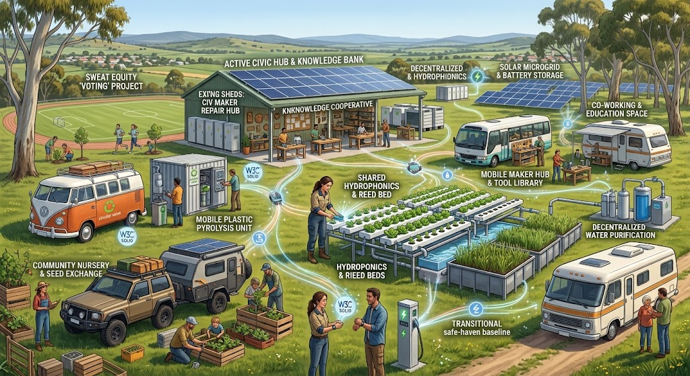

# Community Grounds graphics overhaul: implementation handoff

Date: 2026-10-11 (Australia/Sydney). Status: **implementation active; full graphics and gameplay acceptance outstanding**.

The user wants a radical improvement to the game's graphics, models and environment, with [communitygrounds.jpg](https://dev.civics.au/assets/communitygrounds.jpg) as the primary visual target. This document specifies the work sufficiently narrowly for an implementing model to execute one package at a time. It is a game production plan, not an engine-completion claim.

## 1. The result to build

Rebuild Maslows Challenge as an extensible, data-grounded Australian simulation: a navigable national atlas, town and area views, linked real-world community sites, and detailed playable grounds that the player can explore at ground level and manage from above. Use the civics.au / dev.civics.au project data as an underpinning where its existing datasets and public-data inputs are suitable, with each consumed source adapted, versioned and attributed. Preserve the existing campaign, characters, validated actions, saves and two endings. Turn those actions into clearly visible changes to convincing places and lived experiences.

The world has distinct scales and view contracts. Australia-wide geography belongs in map navigation, trip planning and the first-person or aerial/elevated driving context; do not attempt to render the continent as one ground-level scene. Town or area views show local layout and relationships. A town may link one or many geographically distinct Community Grounds components (for example, a hall, workshop, market garden, depot or gathering place); they remain separate sites with their own source facts and playable scenes, connected through their shared locality. A Community Grounds scene is the human-scale place experience, not a container for every feature in a town. Technical render tiles are streaming/LOD chunks and must never be presented as places. These are camera and loading boundaries, not caps on how much of Australia or how many local sites the simulation may eventually support.

Treat a play mode as a focused way to interact with the shared simulation, place graph and campaign/event state. Alongside map, town/area, Community Grounds, Walk and Direct Drive views, support authored personal/interpersonal situation modes and compact job or activity scenarios. Examples include fruit picking, hotel/resort/motel housekeeping or hospitality, making and repairing things in a workshop, repairing a touring rig, cooking and food preparation. A scenario module declares its place or site, roles, inputs/tools, choices/actions, duration or schedule, outcomes, accessibility and content/data provenance. It must use the shared action/receipt and save/replay contracts; a short interaction may be presented like a mini-game, but it cannot create a separate untracked economy or contradict campaign state. These modules are an extensibility contract; the first geographically grounded place need not ship every occupation.

### Grounding in civics.au / dev.civics.au project data

Inventory and adapt the real project artifacts, not only the visual concept. The public project describes place planning, public evidence and local knowledge, a site/energy/water modelling lab, a touring-rig and fit-out pathway, a food-and-health evidence graph, and governed data exchange. Those products have different maturity: some are proposals or preliminary models, the food-and-health page describes a reviewed evidence dataset, and the databox demo uses synthetic data. Each adapter must carry a maturity label as well as ordinary source/version/licence metadata; never make a draft assumption look like a measured fact.

| Project data or model | Simulation connection | Use boundary |
|---|---|---|
| Community planning and public evidence (`/analysis`) | Area-level context for housing pressure, work, study, tourism, services, safety and local opportunity; supports town differences and authored scenario prompts | Keep published public aggregates distinct from local knowledge and authored narrative. Never infer an individual character's need, eligibility, safety or likely behaviour from area statistics; expose definitions, dates, coverage and evidence gaps. |
| Site planner and modelling lab (`/site-planner`, `/model`) | Place/site attributes and assumptions for amenities, operating costs, loads, solar/battery, water/thermal systems and staged upgrades; feeds management choices and visual site state | Mark preliminary or assumed values. Show units and assumptions; calculated scenarios are not engineering design, a live asset condition, or guaranteed savings/income. |
| Walkabout Strategy and fit-out/budget planner (`/walkabout.html`, `/setup.html`) | Touring rig selection, towing/payload/berths, repairs, setup cost, carrying load, job/travel choices | Treat dimensions/costs as versioned game/planning inputs; driving temperatures/handling stay simulation mechanics, not vehicle advice or diagnostics. |
| Food & health evidence map (`/food-health`) | Food-preparation/cooking scenario, menu alternatives, native and regional ingredients, sourcing and trade-off choices | Use public food-evidence IDs/grades and cautions only after licence and clinical review; do not import personal health records or present a game meal as treatment or medical recommendation. |
| Databox, data safe, cooperative project and community ledger concepts | Personal/interpersonal choices about scoped sharing, permission, work contributions, attribution, receipts and community ownership | Keep game people and records fictional/synthetic. No live credentials, personal pods, payments or real access decisions; distinguish concept design from deployed service. |

The cited paths are source-system discovery anchors, not promises that every page publishes a reusable data export. The intended registry is Observatory (`observatory.civics.au`), with related project descriptions on `dev.civics.au`; expected registry inputs include RDF-based Q42 artifacts enhanced with Qualia Logic and VibeScript, plus other public datasets. Their export contract is still being defined. G00.6 records actual files/APIs and confirms permission as they become available. If a product is only prose, a concept, or an interactive demo without a licensed export contract, consume its published definitions and assumptions as reference material and keep its example data synthetic until an approved export exists. A playable offline pack records the source artifact, exact version/snapshot/date, licence and access constraints, data/ontology mapping, transformation code/version, maturity and uncertainty; scenario content then links to those stable provenance IDs. The game has a provisional manifest envelope and digest validator in [37 — project data bridge](37-civics-project-data-bridge.md); it treats payloads as opaque until the producer schema and QualiaDB parsers are ready.

The primary look is **illustrated realism**: believable people, vehicles, buildings and equipment; carefully simplified detail; soft directional daylight; restrained edge definition; varied grass and mature eucalyptus; practical renewable infrastructure embedded in a working community. Detail must survive normal gameplay framing. The reference supersedes the older animated-film/toy-like interpretation where they conflict. The earlier film reference is no longer the primary target.

This is a replacement of foreground and middle-distance blockouts, terrain composition and presentation. A palette change, extra spheres, more polygons on the existing shapes, bloom, or a brighter sky does not complete it.

### Primary reference

- Source supplied by the user: <https://dev.civics.au/assets/communitygrounds.jpg>.
- Local review copy: `docs/reference/communitygrounds.jpg`.
- SHA-256: `526b1e46845d217eb19e665d0ae2762dbaa884c21bf148720ec59374b118dab0`.
- The copy is a design reference; it is not a runtime texture or a claim of redistribution rights. Keep it outside the exported `web/` package. Author game models and materials through the existing Qualia workflow.

### What to carry across from the image

| Observed characteristic | Required game translation | Reject |
|---|---|---|
| Elevated oblique view, foreground activities, central hub and distant rolling hills | A composed overview with a clear central workshop/hub, layered depth and an inhabited foreground | Flat isolated tiles, empty space surrounding disconnected props |
| Long solar-roofed shed with open working bays | A hero workshop with individual panels, posts, roof framing, benches, shelving and visible interior depth | A closed coloured box with a roof slab |
| Several recognisable kinds of mobile dwelling and vehicle | Distinct campervan, caravan/motorhome, utility vehicle and mobile workshop silhouettes, with glazing, wheel arches, doors and roof equipment | One stretched capsule reused for all vehicles |
| Adults with ordinary human proportions, doing recognisable tasks | Individually designed residents; hands, faces, clothing and grounded work poses | Ball heads on tubes, mitten blocks, giant heads or uniform cloned bodies |
| Raised beds, hydroponic channels, reed beds, pipes and treatment tanks | Legible infrastructure assemblies with materials and connections that explain their function | Coloured rectangles labelled as sophisticated equipment |
| Mature gums framing the image and smaller planting within the site | Tapered branching trunks, hanging leaf clusters, varied age and canopy silhouettes | Identical lollipop trees or sphere-canopy substitutions |
| Green and straw-coloured grass, ochre paths, cream vehicles, blue panels and grey metal | A coordinated material palette with local variation and controlled saturation | Every asset given the same green/brown recolour |
| Bright blue sky, warm sun, soft shadows and atmospheric hills | Stable daylight, contact grounding, readable shaded interiors and restrained distance haze | Heavy fog, excessive bloom or crushed shadows |
| People, produce, tools and furniture arranged in activity clusters | Authored areas for growing, repairing, learning, arriving and gathering | Random prop scatter or uniform procedural density |
| Glowing curved utility connections and explanatory labels | Optional power/water/data overlays anchored to real infrastructure; concise contextual labels | Permanent neon lines or image lettering painted into the world |

Do not reproduce the reference's apparent lettering errors. Use readable, original in-game labels. The infrastructure is fictional scenario content, not an engineering installation specification.

## 2. Baseline and boundaries

The inspected local baseline is game commit `9c52d96db08673d7f579f14f83ac18ba7b4bdc57` and Qualia commit `9463dc6231a0ce10e04ea2837c039e9ec3018fb0`. The game pin has been expanded to the full Qualia commit because the local and Pages build scripts compare it to full `git rev-parse HEAD`. The user reports GitHub Actions processing the updated repositories; this plan does not assert those runs have passed.

The newer commits add graphics capabilities and VibeScript authoring/host interfaces. Use that work. Do not restart the earlier engine programme. However, capabilities must reach the actual game render path:

- `GamePortal` in `crates/rolling-commons-shell/src/lib.rs` still contains a producer report and temporal schedule contract that return unavailable/false values. Replace these with supported engine receipts once connected; do not make the fields true by fiat.
- The current `load_hmc_scene` wrapper unpacks `.10d` entries and RGBA values into `load_body_organs_colored`. A rich material/texture/animation scene must retain its engine-owned dependencies and bindings through loading.
- The Vibe `probe` recipe currently produces a sphere. A visible probe marker is not an environment-lighting probe. Likewise, a water plane mesh is not evidence that the water pass ran, and grass geometry is not evidence of collider-driven foliage motion.
- Existing graphics documents 31–34 disagree about verification. Carry evidence forward by commit, target and executed fixture, not their summary percentages.
- Source counts in older documents are inconsistent. Generate the current inventory from manifests before estimating replacement coverage.

Follow [13 — QualiaDB-only development contract](13-qualiadb-only-development-contract.md). Game-owned work includes recipes, asset specifications, layouts, scene composition, style configuration, presentation bindings and fixtures. Qualia owns generic geometry generation, materials, animation, rendering, culling, LOD, terrain queries, effects, semantic validation and packaging. Use public APIs; upstream a missing reusable feature instead of creating a second implementation in this repository. Do not introduce Blender, Three.js, Babylon.js, a custom GPU renderer or another geometry engine as a shortcut.

This plan preserves the existing non-combat civic game and campaign while extending its geographic and experiential envelope. It includes the Australia-wide map/trip-planning hierarchy, linked localities, and mode/scenario extension points; it does not require multiplayer or runtime AI. New scenery must not silently imply playable services or resources. Adding a new activity or gameplay action is an explicitly scoped scenario module with rules, data/source provenance, save and replay acceptance.

## 3. Production rules for the implementing model

1. Read this document, the development contract and applicable `AGENTS.md` files. Inspect `git status` and current commits before editing. Preserve unrelated changes.
2. Work in package order below. Begin with the first package whose dependencies are complete. Finish a bounded subtask, verify it and record evidence before widening scope.
3. Treat proposed filenames and schemas below as design targets, not APIs that already exist. Locate actual public Qualia symbols and signatures before calling them. Do not invent methods to satisfy the plan.
4. First create one excellent sample of each asset class. Repeat the approved construction method only after it renders correctly in Map and Walk. A generated mesh file alone is not an approved sample.
5. Keep semantic IDs stable. Record explicit old-to-new mappings where one old asset becomes multiple model parts. Never bind saved state to array position or triangle number.
6. Build source assets and regenerate outputs through the existing pipeline. Do not hand-edit `.10d`, HMC or generated WASM/glue. Keep expensive authoring and decoding outside the frame loop.
7. Cosmetic clocks and effects must not mutate campaign day, resources, decisions or replay. Project completion visuals begin only after an accepted action receipt. A denied order cannot briefly show the successful world.
8. Validate observable outcomes. Compilation, a policy boolean, a named recipe or a passing manifest hash cannot substitute for rendered pixels, motion, correct picking or measured performance.
9. For a blocked feature: record the smallest failing fixture, actual API/target, owning Qualia module, required fix and dependent tasks. Continue independent work. Do not quietly replace required character animation or materials with static stand-ins and mark the package complete.
10. Do not change the agreed visual target to accommodate a failed implementation. Report partial completion precisely. Do not mark unfinished work complete because the model's session is ending.

### Durable handoff files to create in package G00

- `docs/planning/36-community-grounds-implementation-tracker.md`: task status, dependency, changed paths, validation and next action.
- `docs/planning/37-civics-project-data-bridge.md`: existing civics project artifacts, maturity/licence distinctions, data-to-mode mappings and adapter completion gates.
- `docs/art/community-grounds-art-bible.md`: visual decisions, dimensions, palette, material specifications and approved sample captures.
- `docs/art/asset-replacement-register.csv`: complete existing-asset inventory and disposition.
- `docs/art/graphics-capability-matrix.md`: engine symbol, game binding, target, receipt and dependent tasks.
- `docs/qa/graphics-overhaul/`: dated evidence index, capture metadata, performance summaries and failure reproductions. Keep large recordings in linked artifacts rather than duplicating binaries throughout the repository.

Tracker statuses are `todo`, `in-progress`, `blocked`, `implemented-awaiting-validation`, and `accepted`. Every task must have one. Suggested row fields: `ID | dependency | status | implementation files | evidence | unresolved issue | next exact action`.

At each handoff, record the current game/Qualia commits, last completed task, exact next task, commands actually run with results, capture filenames, outstanding upstream work and uncommitted changes. A future model must be able to continue without reconstructing chat history.

## 4. Scene and art specification

### Overall composition

Community Grounds becomes the default presentation for new users. Preserve existing Storybook/Earthlight preferences and functional saves; modernise their materials after the primary style is accepted. Art style and hardware quality are independent settings.

Compose Kestrel around five connected spaces: arrival/mobile homes; the solar workshop and learning hub; growing beds and shared water; an open social green; and service/storage edges. Retain existing action locations or migrate their presentation coordinates with stable IDs. The player's eye should travel from foreground gardening and residents to the workshop, through the open green and into the highlands. Leave routes and deliberate open areas between activity clusters.

Place large eucalyptus at scene edges as framing elements, medium trees behind activity areas, and smaller planting near paths. Preserve sightlines from standard Map/Survey cameras to the workshop, tank, shelter, mast and crossing. Inspect every major structure from the back and sides in Walk; no single-camera facades.

Connect Kestrel, Saltwind and the highlands into one landscape. Replace visible square skirts with continuous landforms, drainage banks and background terrain. Retain the canal's gameplay identity. Extend the reference's art language to the bridge, orchard, quay, boat and wind pump rather than transplanting reference objects mechanically into unrelated locations.

### Model family specifications

These are minimum production families, not requests to inflate asset counts. Inventory every currently visible asset; replace, finish, merge or intentionally retire each one. Decorative descendants retain their parent site's semantic identity where appropriate.

| Family | Required final construction | Required visible states / motion |
|---|---|---|
| Workshop / civic hub | Separate roof panels and rafters, structurally readable posts, deep open bays, door frames, guttering, signs, benches, shelves, tools, battery/control area; convincing rear and side elevations | Offline, powered, repair activity; lights and equipment respond to validated power state |
| Home on wheels / camp | Believable chassis, tyres and wheel arches, doors and handles, framed windows, hitch or cab, roof equipment, awning, steps, deck and personal-scale furniture | Initial dwelling and shelter upgrade remain recognisably the same home; awning secondary motion if supported |
| Additional vehicle families | Distinct utility vehicle with trailer, motorhome/caravan and mobile workshop body; axles, suspension suggestion, glazing, seals, mirrors, lamps and useful roof loads | Parked baseline; doors/equipment in use where authored. Travel requires a real route/controller, not scenery drifting through people |
| Water system | Tank with curved wall response, bands/seams, valves, pipes, fittings, pump and ground connections; purposefully arranged treatment/reed-bed display where appropriate | Dry/repaired/flowing; clearly bounded water effects; no invented resource production from decorative equipment |
| Solar / battery / communications | Individually framed blue-black solar panels, cell pattern, rails, wiring, inverter, enclosure and legible mast components | Installed/uninstalled, powered/offline, mast commissioned; optional network overlay |
| Community growing areas | Timber raised beds, soil surface, individual recognisable leafy plants, crop density variation, crates, irrigation; one hydroponic/reed-bed display assembly inspired by the reference | Empty/planted/grown/harvested visuals follow existing rules; leaves and reeds move coherently |
| Mature gums and wattle | Tapered irregular trunks, major forks, secondary branches, bark variation, species-readable hanging leaves or flowers; several purposeful silhouettes | At least 3 gum silhouettes and 2 wattle forms; wind, distance simplification and near-player bending where appropriate |
| Ground-cover families | Grass tufts, dry grass, reeds, lavender, herbs, crop leaves, small rocks and flowers; location-specific density | Stable seeded placement; worn paths and work areas stay clear; coherent wind phases |
| Residents | Believable body proportions, distinct face/hair/clothing silhouettes, separate fingers or readable hand forms at hero distance, footwear and articulated clothing volumes | Idle, walk, carry, repair, garden, converse/point and gather; expressive head/hand movement; compatible reduced-motion presentation |
| Saltwind structures | Engineered-looking bridge deck/supports/rails, barn, wind-pump assembly, quay and trade boat with readable planks, frames, fittings and mooring details | Damaged/braced/open bridge, commissioned pump, loaded boat and gathering alternatives |
| Everyday props | Benches, tables, noticeboard, tool storage, crates, produce, hoses, planters, salvaged materials, lamps, bins and appropriate signs | Stock/state variants where already meaningful; no decorative noise obscuring interaction |

Dimensions must be defined in source-world metres. Calibrate with an adult approximately 1.7 m tall and ordinary doors approximately 2 m tall, allowing authored variation. Use these as consistency guides, not mandatory uniform sizes. Verify the existing scene normalisation before changing scale: geometry, camera, shadows, collisions, terrain height and picks must agree.

### Australian touring and direct driving

The touring choice is a real gameplay loadout: campervan, 4WD with caravan, car with camper-trailer, or 4WD with roof-top tent. Each has its own authored vehicle geometry and a declared handling envelope for acceleration, braking, steering and safe road-shoulder tolerance. The local first-person Drive mode is a controllable short road through the Kestrel–Saltwind demo ground, with throttle, reverse/brake, steering, low-speed animal encounters and a clear end-of-fixture boundary. It remains separate from campaign-day progression until travel is integrated with the world route graph.

The first corridor is the user's broad Noosa-to-Melbourne coastal reach with inland coverage toward the South Australian border. It is not one IBRA unit or one uniform wildlife list. Regional packs must select their own roads, terrain, flora, fauna and seasonal data. The current original model set covers goats, horses, rabbits, kangaroos, wallabies, wombats, deer, snakes, goannas, kookaburras, and crows with a non-graphic roadkill actor. The combined showcase is explicitly illustrative on the fictional demo road; it is not a geolocated occurrence or a claim of co-occurrence at a real site. Broad animal groups remain unresolved until the regional profile selects local taxa. Dawn/dusk/night settings extend warning distance, adjust encounter risk and change presentation lighting; they are gameplay cues, not sourced wildlife-activity data. The drive also models simulated oil and water/coolant temperatures from ambient heat, road surface, grade, throttle and rig load, with warnings and engine condition. Trailer rigs build a following traffic queue and obscure the centre rear view until a bend reveals it. These are driving-game simulations, not vehicle diagnostic guidance or measured road data. ALA observations may inform a reviewed place profile, but a sighting or distribution layer alone does not prove that an animal is on a road or quantify collision risk.

The offline ALA import/report pipeline accepts a separately bounded source CSV, DOI/query metadata and any versioned region profile. It aggregates occurrence records without copying coordinates, preserves the data needed for attribution/licence review and cannot enable runtime rendering by itself. Model selection and road-risk placement require explicit profile approval. Keep the profile interface Australia-wide; the first corridor is one configuration, not a geographic or taxonomy limit. See [Australian ecology data contract](../art/australian-ecology-data-contract.md) and [Australia atlas/travel plan](29-australia-world-atlas-and-osm-pack.md).

### Surface specification

Create a shared material library before mass-producing models: painted cream metal, galvanised metal, dark rubber, framed glass, solar glass/cells, timber, bark, soil, worn gravel, grass, foliage, cloth, plaster and water. Each material defines base colour, roughness, metallic response where relevant, normal detail, alpha mode, UV scale and supported texture roles. Only metals are metallic. Normal/roughness/AO maps use their intended linear interpretation; base colour uses the engine's documented colour space.

Use geometry for silhouettes, wheel arches, roof thickness, frames, hand forms and large folds. Use surface detail for grain, shallow seams, bark variation and cell patterns. Bevel important edges through supported Qualia authoring so daylight reveals shape. Do not bury missing topology under noisy textures. Keep soil, tyres, fabric and timber visibly distinct under the same neutral light.

Initial approximate palette guides, to tune against captures rather than treat as image samples: foliage `#657448`, dry grass `#A4A36A`, pale bark `#C4BE9D`, ochre path `#B4976F`, cream paint `#E3DFC7`, panel blue `#314C67`, dark framing `#46504B`, warm timber `#94704A`. Avoid global tinting that destroys skin tone, blue panels or material distinction.

Default to warm, moderately directional daylight and a pale blue sky. Use soft cast shadows, contact AO, environment light in shaded areas and gentle atmospheric perspective. Exposure should show interior benches and exterior panels simultaneously without whitening all highlights. Thin outlines, if used, are a supported engine feature and must remain subtle; do not impose thick cartoon borders. Reserve bloom for small luminous elements. Depth of field and motion blur stay off during normal play; cinematic options must not obscure gameplay.

### Animation specification

Complete one rigged resident before expanding the roster. Approve proportions and poses from front, side and three-quarter views, then inspect in the actual world. Locomotion must match travel speed, feet must meet ground, tools must meet hands and work surfaces, and carried items must not pass through the torso. Clip transitions must not teleport the person or reset their semantic identity.

Use the existing resident roster in `web/characters.mjs` as the identity source. Define reusable rig/clip families plus distinct face, hair, clothing and body proportions. Connect accepted project actions to bounded visual activities; an activity is not an alternative simulation. Ambient residents can follow approved cosmetic loops, with no fabricated resource or campaign consequences.

Treat skeletal clips, skinning, attachment points, terrain placement and blending as explicit integration requirements. The general artefact animation entry point does not by itself prove a production character pipeline. Missing functionality becomes a Qualia task, while architecture/terrain work continues.

## 5. Capability-to-scene integration matrix

The final matrix created by G00 must cite actual symbols and receipts. This table defines what to demonstrate, not a claim that every feature is exposed today.

| Capability | Player-visible showcase | Required evidence |
|---|---|---|
| `.10d` materials, normals, textures and HMC dependencies | Timber, cloth, rubber, foliage, glass and solar panels in one workshop view | Pack round-trip, correct bindings and same-light material comparison |
| Environment probes / indirect light | Shaded workshop bay and reflective panel/metal surfaces | Actual probe configuration reaches GPU; controlled on/off capture changes the intended surfaces |
| Shadows and AO | Residents, vehicle wheels, benches, tree foliage and bridge supports meet the ground | Stable moving-camera footage, no detached shadows or haloed edges |
| Temporal reconstruction | Slow pan past thin panel rails, foliage and moving residents | Observed producer/pass receipts plus moving/disocclusion capture; no fabricated readiness |
| KTX2 and texture residency | Sharp nearby hero assets and economical distant materials | Tested supported format/mip path, measured uploads/residency and readable fallback; do not equate KTX2 container support with every Basis format |
| Water | Canal against bridge piers, shore banks and reeds | Real water pass, depth interaction, foam at contact, transparent ordering and quality-tier comparison |
| Vegetation / instancing | Mature tree canopy and grass/reeds near a walking resident | Coherent wind, collider response, bounded instance pool and visible distance behaviour |
| Terrain / LOD / culling | Walk from growing beds to bridge, then Survey to highlands | No cracks or floating props; correct ground queries; repeatable residency and transition measurements |
| Rigged animation | Gardening, repairing, carrying and conversation | Pack-to-browser skin/clip playback and transitions with grounded hands/feet |
| Effects and atmosphere | Pump flow, restrained dust, moving foliage and distant hills | Engine-owned bounded effects; no orphan emitters after scene changes or replay |
| Semantic selection | Select a resident, workshop or crossing through the new geometry | Stable ID, correct site/action, occlusion and HUD behaviour at each camera distance |
| Quality and recovery | Same campaign on admitted device tiers | Actual backend identified; supported fallback and device-recovery exercise |
| Capture / observability | Reference overview and reproducible tour | Saved camera/state/seed, build hashes, frames and performance metadata |

Full volumetric clouds, screen-space reflections, refraction extensions, native ray queries and advanced skin shading are separately assessed enhancements. Do not advertise them from suggestive names or enable them at the expense of the agreed scene. If required to achieve an approved asset, record the specific dependency; never use them as a substitute for finishing models.

## 6. Ordered implementation packages

Dependencies: `G00 → G01 → G02 → G03 → G04 → G05 → G06 → G07 → G08 → G09`.
After G03, environment and character authoring can advance independently within G04–G06 when their interfaces are stable. A single model may execute everything sequentially; no agent swarm is required.

### G00 — Freeze the baseline and make work measurable

**Inputs:** current repository state, reference image, manifests, existing campaign fixtures and Actions results once available.

- G00.1 Record full game/engine SHAs, current workflow run URLs/status and actual deployed build identity. A pending or failed run is not the baseline proof. Do not assume the browser package matches current source.
- G00.2 Resolve `qualia.ref` to the intended full SHA. Both `scripts/build-game.ps1` and `.github/workflows/game-pages.yml` compare it with full `git rev-parse HEAD`; fix pin/verification consistency before the reproducible build. Do not advance the engine pin to unrelated work.
- G00.3 Generate the asset replacement register from all three style manifests and the source catalog. Fields: stable ID, parent semantic site, family, source recipe, states, material roles, LODs, current disposition, replacement task, capture and acceptance. Enumerate residents and every current campaign scene.
- G00.4 Create the tracker, art bible and capability matrix specified above. Keep historical docs as history and link the new plan from their relevant entry points without relabelling old evidence as new.
- G00.5 Capture baseline Map, Survey and Walk views, including workshop, camp, garden, bridge, orchard and highlands; capture both endings and all current style presets. Record missing tooling or unavailable hardware explicitly.
- G00.6 Inventory the existing civics.au / dev.civics.au project datasets and generated outputs before selecting in-game inputs. Record owner, schema, version/update cadence, geography/time range, licence/access terms, units/definitions, uncertainty and privacy constraints; define versioned adapters rather than duplicating a source of truth. Keep the findings in [37 — project data bridge](37-civics-project-data-bridge.md), then finish artifact-level export/permission checks against the producer repositories.

**Exit:** a reproducible baseline and complete inventory exist; commands and images are linked. The current source tracker records that visual capture remains outstanding. No art-quality completion is claimed.

### G01 — Establish the composition and reference cameras

**Depends on:** G00.

- G01.1 Add repeatable camera/state fixtures under proposed `web/fixtures/graphics/`. Use source-world camera data compatible with actual Qualia camera APIs. Include viewport, campaign setup, style, quality, lighting time and random seed.
- G01.2 Keep the six named scene review views and add fixtures that prove the scale/mode boundaries: Australia atlas/trip planner, town/area overview, separate linked local sites, Community Grounds overhead and ground level, first-person and aerial/elevated drive, personal/interpersonal choice, and focused work interaction. Add one fixed 30-second movement route through the workshop, garden and canal; later add an extended route through local regions.
- G01.3 Recompose Kestrel around the hub, productive garden, mobile homes and open green. Use temporary placements only to lock scale, paths and sightlines. Keep these labelled blockouts.
- G01.4 Write dimension and material sheets for the workshop, hero resident, campervan, mature gum and garden assembly. Include front/side/overview requirements and part lists from section 4.

**Exit:** consistent real-world scale and cameras, reference-based layout and precise hero specifications. The reference overview contains a recognisable hub, solar roof, mobile dwellings, productive foreground, mature trees and distant landscape.

### G02 — Connect the production graphics path

**Depends on:** G00–G01. **Main files:** `src/lib.rs` under `crates/rolling-commons-shell`, `web/game.html`, asset export/build scripts; Qualia APIs by actual ownership.

- G02.1 Trace recipe → compilation → material/texture sections → HMC → game load → renderer submission. Build a small original multi-material fixture with metal, timber, glass/alpha and foliage. Verify all dependencies survive this exact route.
- G02.2 Replace the coloured-mesh-only route for upgraded content with supported material-preserving scene loading. Retain authored transforms and stable semantic identity. If Qualia lacks a public multi-asset entry point, implement/expose and test that generic entry point upstream first.
- G02.3 Expose actual engine settings and receipts through thin `GamePortal` bindings for supported lighting, AO/shadows, exposure, probes, quality, water, vegetation and temporal operation. Prefer engine-owned state and admission. Host invocation registration alone is insufficient: trace a setting to the renderer instance used by this canvas.
- G02.4 Connect temporal rendering using the engine's real producers. Ordinary camera movement must reproject history; camera cuts, incompatible scene changes, resize and quality changes must invalidate it correctly. Remove stale hard-coded false reports only when they are replaced with observations.
- G02.5 Separate visual preferences, campaign state and hardware policy. Remove duplicate game-side policy guesses where public Qualia policy exists. Ensure current presentation rebuilds do not discard materials or reset playback every frame.
- G02.6 Establish engine-owned quality degradation and clear unavailable-feature handling. Keep input, semantic selection and campaign actions working through admitted fallbacks.

**Exit:** the original material fixture, real water/probe/vegetation integration and moving temporal fixture execute in the game WASM/browser path with honest receipts. An unexposed required feature remains blocked, not silently emulated.

### G03 — Produce the material library and reusable asset contract

**Depends on:** G02.

- G03.1 Create the material families in section 4 using supported Qualia authoring/compilation. Put source descriptions in a proposed `assets/source/materials/` tree or the repository's established equivalent. Define UV scale, normal/tangent handling, texture roles and alpha behaviour explicitly.
- G03.2 Create shared model metadata: stable asset ID, parent site, units, pivot, bounds, material slots, texture dependencies, state variants, rig/clips, LOD policy, picking/collision representation and provenance. Adapt to the actual Qualia schema; do not invent a private replacement container.
- G03.3 Split large game-owned recipes into focused source modules when necessary: proposed `src/art/{materials,buildings,vehicles,characters,botany,props}.rs`. Leave `asset_catalog.rs` as registration/composition. Preserve recipe hashes/provenance through supported compilation.
- G03.4 Add export validation for missing material/texture dependencies, invalid transforms/bounds, non-finite data, duplicate semantic IDs and unknown state references. Validate supported version compatibility and typed failure behaviour.
- G03.5 Prove reuse: one material referenced by two models must not produce avoidable duplicate residency. Validate normal/colour/alpha mip behaviour at Map and Walk distances.

**Exit:** an in-engine material board, reusable recipe contract and validated packaging path. The material board is a development fixture, not a replacement for the playable scene.

### G04 — Finish one complete reference-quality scene

**Depends on:** G01–G03. This is the first major visual milestone.

- G04.1 Rebuild the workshop and solar roof to the full family specification. Add a furnished bay, readable structure and logical access paths. Show offline and online versions.
- G04.2 Replace the camp vehicle with a recognisable home-on-wheels model, including believable windows, tyres, chassis and domestic details. Complete the existing shelter upgrade visually.
- G04.3 Finish one mature gum, one wattle cluster, a raised garden assembly, a hydroponic/reed-bed display and one resident at final static model quality. Rigging is completed in G06; the static pose is not animation acceptance.
- G04.4 Replace the local ground with graded terrain, gravel/worn paths, planted edges and grass distribution that respects movement/work areas. Connect geometry, ground sampling and picks.
- G04.5 Light and frame the reference overview. Compare directly with the saved reference for depth, proportions, infrastructure detail, vegetation hierarchy and inhabited activity. Review at 1920×1080 and the actual application viewport.
- G04.6 Iterate geometry and composition before adding effects. Capture the five hero assets from at least three views and in ordinary Map/Walk use.

**Exit:** the workshop/camp/garden scene is visibly transformed and passes the rubric in section 8. Do not scale a rejected hero design across the map. Store the accepted capture set and design parameters so the next model can reproduce the standard.

### G05 — Rebuild the connected environment and remaining models

**Depends on:** G04.

- G05.1 Finish terrain transitions from Kestrel through the canal to Saltwind and the highlands. Add graded banks, road margins, drainage, rock outcrops and layered distant hills. Remove visible tile walls and terrain cracks in normal views.
- G05.2 Complete the botanical families and placement rules: gum/wattle variations, reeds, grass, herbs, lavender, orchard and crops. Encode stable seed, density masks, slope/ground constraints and exclusion zones through Qualia-owned tooling.
- G05.3 Finish tank, pump, battery, mast, market, hall, salvage area, storage and every existing Kestrel landmark to the same material and geometry standard.
- G05.4 Finish the utility/trailer, motorhome/caravan and mobile workshop families as authored scenery or replacements where appropriate. Budget these within the scene; new vehicles do not imply new gameplay mechanics.
- G05.5 Rebuild bridge supports/deck/bracing, Saltwind barn/market, wind pump, orchard, quay and trade boat. Preserve all late-bridge and harvested-orchard states and the distinction between the two endings.
- G05.6 Finish props by activity cluster: tools by benches, crates by harvest/storage, seating by gathering areas, pipes between connected water elements. Check clearance and walkability.
- G05.7 Audit the replacement register. Every visible blockout must be replaced, brought to the accepted standard or deliberately removed with a documented reason and no lost interaction.
- G05.8 Keep the place graph hierarchical: Australia routes and map data → locality/area → one or many distinct Community Grounds sites → streamed technical tiles → assets. Build and load each real site from its own extent and source profile; never combine a town into one invented ground or treat render tiles as places.

**Exit:** no region retains a lower-quality foreground left over from the prototype. All campaign states have finished art; the extended Walk route is continuous and correctly grounded.

### G06 — Bring residents and infrastructure to life

**Depends on:** G03–G04; integrates with G05.

- G06.1 Establish the supported rig/skin/clip pipeline using one resident and the seven action families in section 4. Check export/import, attachments, joint limits, normals under deformation and clip transitions.
- G06.2 Replace the remaining roster using shared rig families and original individual designs. Verify character selection/creation still resolves to the intended identity and saved location.
- G06.3 Author workshop repair, growing/harvesting, carrying and conversation loops. Bind action-driven sequences to accepted receipts and existing world state. Define interruption, reload and scene-switch behaviour.
- G06.4 Activate engine-owned foliage wind/colliders, pump motion, water flow and restrained work effects. Use bounded counts and lifetimes. Wind should vary by species/stiffness rather than move every object identically.
- G06.5 Keep visual time separate from campaign day and tide rules. If adding a day/evening presentation preset, do not advance the day counter or unlock/disable orders by changing the sky.
- G06.6 Implement reduced motion, independent effect density and stable poses without losing project-state feedback. Avoid mandatory camera shake or motion blur.

**Exit:** a 30-second capture shows readable residents performing activities, coherent foliage/water and correct hand/foot contact. Save/reload and replay reproduce the correct state without replaying one-time completion effects incorrectly.

### G07 — Make the visual world readable and demonstrable

**Depends on:** G04–G06.

- G07.1 Refine Map, Survey and Walk framing, movement, near/far planes and collision using Qualia's supported controls. Avoid clipping through vehicles, buildings and terrain. Character height must match scene scale.
- G07.2 Replace obtrusive debug markers with clear contextual selection cues using the supported renderer/UI. A label appears on selection or useful proximity; it must not turn every frame into a diagram.
- G07.3 Add optional power, water and communications overlays inspired by the image's utility lines. Resolve endpoints from actual semantic links/status. An inactive network must not glow as operational.
- G07.4 Give each accepted project a readable short visual result: panel installation, workshop commissioning, water flow, bracing, harvest crates, commons gathering or boat preparation. Keep the rule explanation accessible beside it.
- G07.5 Provide a separate guided showcase route using a disposable demo world or read-only presentation state. It must not overwrite the user's campaign. Include a cancel control and a return to normal play.
- G07.6 Provide hidden-HUD capture and optional diagnostics for developers. Ordinary players see concise settings; backend/resource details belong in diagnostics. Ensure keyboard selection, high-contrast cues, readable text and colour-independent project states.
- G07.7 Add mode adapters over the shared place graph, validated action receipts, actor/inventory state and campaign save/replay contract. Implement map/trip planning, locality/site navigation, first-person drive and optional aerial/elevated drive as views with appropriate geographic scope.
- G07.8 Add a versioned personal/interpersonal scenario contract for authored interactive-choice stories and work/activity modules. Each module declares place, roles, controls/accessibility, entry/exit conditions, tools/materials, duration, choices/actions, state effects and source/content provenance. Use representative fixtures for a conversation/choice, fruit harvest, workshop or touring-rig repair, and cooking/food preparation; hospitality/housekeeping must be addable through the same contract. Scenario receipts must resolve to shared state and replay without creating an untracked side economy.
- G07.9 Show an illustrated Australian loading screen immediately on first online entry and whenever a scene/style/place pack must load. Use real byte progress when the server supplies a known content length and an honest animated indeterminate state otherwise; announce preparation, download, validation and ready/fallback stages. On fatal load failure, keep the overlay, explain the retry, and provide a retry control. Respect reduced-motion settings and never claim that unavailable geographic content loaded.

**Exit:** the game communicates why a place changes; the player can navigate between Australia, a town/area, linked local sites and a selected human-scale ground without scenery substitution; and the showcase demonstrates driving and grounded situation/activity modes using shared simulation state.

### G08 — Optimise, qualify and finish all styles

**Depends on:** G05–G07.

- G08.1 Measure the overview, dense garden, workshop bay and extended route before optimisation. Record CPU/GPU timing separately when available; do not call a wall-clock measurement GPU time.
- G08.2 Apply engine-owned instancing, culling and LOD to plants, panel assemblies and repeated props; tune material batching and texture residency. Reduce invisible/repeated detail before damaging hero silhouettes.
- G08.3 Define Low/Balanced/High from measurements. Retain all semantic targets and campaign states at every tier. Lower tiers reduce texture resolution, distant density, shadow/AO cost and optional effects; they do not erase important structures or residents.
- G08.4 Exercise repeated traversal, style switching, resize, device loss/recovery where supported, hidden-tab return and scene/state changes. Check stale resources and monotonic memory growth.
- G08.5 Apply coherent Storybook and Earthlight material/lighting variants to the upgraded geometry. Keep saved user style choice. Do not duplicate every geometry/texture across style packs unnecessarily; use supported shared dependencies where available.
- G08.6 Tune loading: pair the G07 loader with useful scene/pack progress, avoid compiling the whole world in the interactive frame loop, prioritise the selected site and nearby tiles, and measure initial/cached load. Handle missing or corrupt content explicitly and retain a labeled local fallback when it is valid.

**Exit:** recorded performance and platform gates pass for the declared support matrix, all styles remain functional and Community Grounds remains the reference-quality default.

### G09 — Final acceptance and release handoff

**Depends on:** G00–G08.

- G09.1 Run the complete campaign suite, both endings, late bridge/bracing paths, orchard choices, optional mast/contract, character saves, old-save migration, denied-action feedback and replay.
- G09.2 Rebuild all shipped style packs and WASM from the pinned engine. Verify output/manifests and browser-loaded build hashes. Run actual browser tests in addition to compilation.
- G09.3 Review the six standard frames and both movement routes against the reference and rubric. Check all model families and campaign states through the replacement register.
- G09.4 Update README, asset catalog and capability ledger with the actual resulting behaviour and measured support. Remove stale claims that are contradicted by the completed work, while retaining historical receipts.
- G09.5 Produce a release evidence index: before/after frames at matched views, a short playable showcase recording, full asset inventory, performance/platform table, game/engine SHAs and any explicitly unaccepted optional enhancements.
- G09.6 Verify the deployed build after the normal release workflow when deployment is authorised. A local screenshot or passing build job is not deployed acceptance. Do not overwrite or redeploy while another workflow's result is still being used as evidence without identifying the newer build.

**Exit:** all required tasks are accepted, visible quality is approved against the reference, and the release can be reproduced and played. If required work remains blocked, deliver the precise remaining list instead of declaring the overhaul complete.

## 7. Files and ownership map

All paths in this table are repository-relative. Proposed paths should be created only when their package needs them.

| Existing location | Intended changes |
|---|---|
| `crates/rolling-commons-shell/src/asset_catalog.rs` | Replace/register game models and variants; move growing source families into focused modules |
| `crates/rolling-commons-shell/src/terrain.rs` | Author landscape inputs, seams, placement/height consistency through Qualia geospatial APIs |
| `crates/rolling-commons-shell/src/lib.rs` | Thin public engine bindings, recipe/scene composition, material-preserving loading and real renderer receipts |
| `web/game.html` | Scene lifecycle, cameras, style/quality controls, semantic interactions, project feedback and fixtures; extract cohesive modules if needed |
| `web/characters.mjs` | Preserve roster identity and presentation mapping; connect new visual character definitions |
| `web/fixtures/` | Existing actions/seed remain authoritative; add separate deterministic visual fixtures |
| `scripts/export-game-assets.mjs` | Export complete dependency graphs and variants, validate manifests, generate inventory and provenance |
| `scripts/build-game.ps1`, `scripts/ci.ps1` | Reproducible engine pin, real validation steps and clear failure results |
| `.github/workflows/game-pages.yml` | Build/artifact identity and release checks; add browser qualification with explicit hardware/adapter provenance |
| `assets/generated/`, `web/assets/`, `web/pkg/` | Regenerated outputs only; maintain pack/WASM consistency |
| Qualia `render/`, `domains/geospatial/`, geometry authoring and Vibe host modules | Generic capability fixes, schema/bindings and upstream tests; follow Qualia's repository instructions |

Do not expand `web/game.html` with private material, animation, terrain or GPU algorithms. A module extraction should preserve behaviour and have a narrow purpose; avoid a wholesale unrelated rewrite before the first visual milestone.

## 8. Acceptance and performance contract

### Visual review rubric

Score each category from 0 to 3: **0** absent/broken; **1** blockout; **2** convincing but visibly unfinished; **3** matches the reference's level of care at gameplay distance. Store captures and reasons, not only numbers. Final acceptance requires 3 in every category for the six review views where applicable. A numeric self-assessment does not replace viewing the images; final subjective fidelity should be presented to the user for review.

| Category | What a 3 requires |
|---|---|
| Composition | Central civic/workshop focus, layered activities, clear paths and distant landscape; no floating tile presentation |
| Architecture and infrastructure | Detailed structure, solar assemblies, equipment and interior depth; function readable without a label |
| Vehicles | Distinct credible vehicle types, glazing, chassis and useful details; grounded wheels and consistent scale |
| People | Believable proportions, distinct identities, readable hands/faces/clothing and convincing task poses/motion |
| Botany and terrain | Recognisable gums/plant families, varied distribution, joined landforms, worn paths and shore transitions |
| Materials and light | Surfaces respond differently, shadowed areas remain readable, contact grounding and restrained illustrated finish |
| Motion and continuity | Stable temporal edges, grounded animation, coherent wind/water, smooth LOD and no disruptive state pops |
| Gameplay readability | Important projects selectable and visible; feedback, HUD and overlays support the scene without covering it |

The mode/scope review must confirm that Australia-wide extent appears in atlas/trip planning and selected-route driving contexts; town/area views show their own layout; linked grounds load as separate places; and scenario/activity outcomes are validated, replayable changes to shared state. Interactions that are unauthored, unsourced or unvalidated must not imply real-world service/access facts or present day-to-day tasks as facts about real people.

The online-entry review must see the Australian loading illustration before the game becomes interactive, track actual pack bytes where measurable, announce when fallback content is active, and let an exhausted or disconnected player retry after a clear loading error. The illustration and activity must remain legible on narrow screens and respect reduced motion.

Automatic rejection examples: foreground blockout people, faceted tyre silhouettes at close view, uniform spherical canopies, missing windows/interiors, z-fighting, floating props, terrain cracks, unreadable signs, smeared moving foliage, glow masking plain geometry, or a polished screenshot that cannot be reproduced in gameplay.

### Initial engineering budgets

These are proposed targets to validate in G00/G04 and freeze with named reference devices in G08; they are not measured claims. If a target proves infeasible, document the measurement and explicit revised budget rather than silently lowering quality.

| Measure | Initial target / test |
|---|---|
| High desktop WebGPU | 1920×1080, device-pixel ratio capped by profile; p95 total frame time ≤16.7 ms on a named discrete-GPU reference device |
| Balanced laptop | 1280×720 internal render target or measured dynamic equivalent; p95 ≤33.3 ms on a named integrated-GPU device |
| Low / fallback | Preserve playable controls, required scene states and clear semantic cues; separately measure and declare supported backend/resolution |
| Traversal stutter | No post-warm-up frame >100 ms in the scripted route without a recorded cause and remediation |
| Managed GPU resources | Initial cap 512 MiB High / 256 MiB Balanced, with separate texture, geometry, frame-target and staging totals |
| CPU/WASM residency | Establish baseline and declared cap per profile; graphics/asset memory is tracked separately from Qualia's 42 MiB semantic execution arena |
| Resource lifetime | Ten repeated region/style traversals settle within 5% of the warmed steady-state managed-resource total; browser heap noise is reported separately |
| Load | Record cold and cached time-to-control and transferred bytes on a declared device/network; set a numeric shipping cap after the first hero slice |
| Scene scale | No fixed polygon-count victory metric; measure submitted triangles, instances, draws, texture/mip bytes and shader cost by view |

Benchmark after 10 seconds warm-up for a 60-second route, three runs per device/profile. Report median and p95 frame time plus worst stall, resolution, browser/version, adapter/backend, build hash and thermal/power conditions where known. Test dense and ordinary areas, not only an empty scene. Distinguish actual hardware from software adapters. Do not infer Safari, mobile or native backend support from a Chromium run; record each target as passed, failed or untested.

### Verification layers

1. **Source/format:** supported mesh/material/rig schema, complete dependencies, stable IDs, bounds, provenance, hashes and repeatable exports.
2. **Engine integration:** actual public API and target profile, validated resource ownership, per-feature execution receipts and narrow GPU fixtures where relevant.
3. **Game behaviour:** campaign rules, state variants, saves/migration, semantic picks, all cameras, both endings and replay.
4. **Visual:** matched captures and movement footage; alpha, shadow, water, material, animation and temporal correctness.
5. **Performance/recovery:** declared profiles/devices, repeated resource lifecycle tests, resizing/recovery and supported fallback.
6. **Release:** matching engine/source/WASM/HMC identity in the deployed browser and completed workflow evidence.

Existing commands to start from: `scripts/ci.ps1 -Step fmt`, `-Step check`, `-Step test`, `-Step wasm`, `-Step assets`; `web/game.html?selftest` for browser campaign checks. **The current `-Step test` compiles WASM tests with `--no-run`; it does not execute them. The current assets step primarily checks output presence.** Add meaningful runtime and dependency validation rather than relabelling these steps as comprehensive tests. Use the repository's available browser tooling and a real WebGPU-capable execution environment; record skipped hardware gates.

For capture determinism, record fixture ID, camera/viewport, saved world or event trace, animation time, seeds, style/quality, lighting, game/engine/WASM/pack hashes and adapter. Use bounded image comparisons for stable scenes plus human/model visual review of geometry and motion; tolerate documented backend variation without masking missing content.

## 9. First implementation session: bounded starting instructions

Execute G00 and G01 first. Then implement G02's material round-trip and engine-binding proofs before mass asset creation. The first art delivery is G04's **finished workshop, campervan, gum tree, garden assembly and resident in one reference-composed scene**. Deliver its captures, package receipts and measurements before expanding to the rest of the map.

Suggested prompt for the implementing model:

> Implement the next ready task in `docs/planning/35-community-grounds-graphics-overhaul.md`. The primary appearance target is `docs/reference/communitygrounds.jpg`. Read the implementation tracker and applicable repository instructions, preserve unrelated changes, and inspect the actual public Qualia interfaces before coding. Complete one bounded work package, regenerate affected artifacts through the supported pipeline, run relevant checks and inspect actual game captures. Update the tracker with evidence and the exact next action. Do not call compilation, a mesh export or a renamed capability proof of visual completion. If a required engine binding is missing, record and address the specific Qualia dependency without building an alternative engine in the game. Preserve campaign semantics, saved identities and both endings. Continue through ready subtasks within the session and leave a precise handoff when stopping.

The overall finish line is a playable, reproducible world whose models, inhabitants, productive landscape and lighting carry the detail and character of the supplied Community Grounds illustration throughout the campaign.
