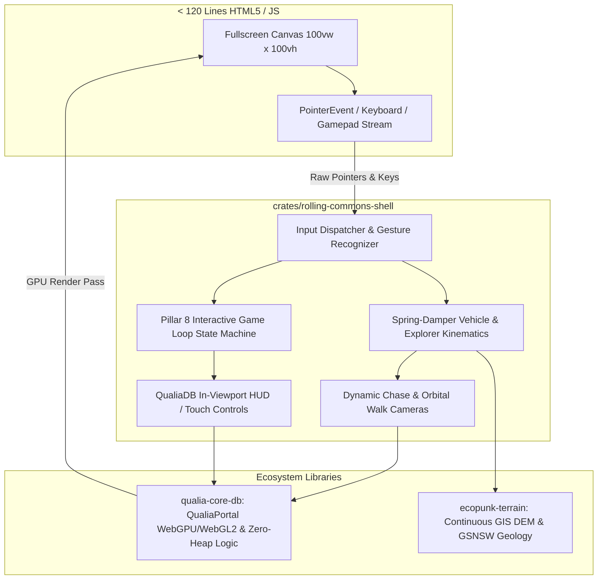
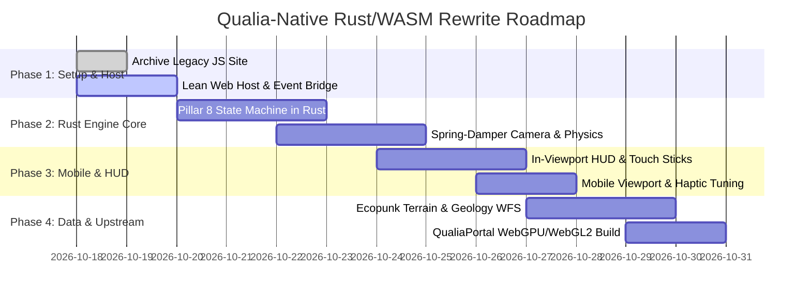

# Plan 43: Qualia-Native Rust/WASM Complete Architecture & Mobile Rewrite

> **Branch:** `feat/rust-wasm-rewrite` (Archived legacy JavaScript site preserved at `archive/legacy-js-site`)  
> **Status:** Approved Architecture & Implementation Plan  
> **Target Substrates:** `c:\github\qualiaDB` · `c:\github\ecopunk` · `c:\github\game-demo`  
> **Core Mandate:** Complete elimination of client-side JavaScript/HTML simulation mocks; pure Rust engine compiled to `wasm32-unknown-unknown` utilizing QualiaDB and Ecopunk libraries.

---

## 1. Executive Summary & Audit of Legacy Misalignment

### 1.1 The Legacy Architecture Failure
The previous iteration of `game-demo` featured severe architectural dishonesty:
1. **The JavaScript Monolith:** While claiming to be a "browser-first WASM application built in the QualiaDB/Webizen ecosystem" with "menus painted by Qualia in the viewport", the implementation was in fact a 4,296-line monolithic JavaScript file (`web/game.html`) and a 743-line file (`web/talbingo.html`) utilizing hundreds of HTML DOM elements, CSS classes, inline SVG, and procedural JavaScript game loops.
2. **Mobile Brokenness:** 
   - A dormant CSS selector (`body:not([data-hud-page="orders"]) .touch-controls { display: none !important; }`) permanently hid on-screen controls.
   - Touch drag gestures conflicted directly with browser scrolling and pull-to-refresh due to absent `touch-action: none` boundaries.
   - Mobile viewport scaling and 48dvh DOM sidebars occluded the 3D canvas and intercepted pointer events.
3. **Upstream Disconnect:** The game failed to leverage the true native in-viewport HUD (`render/hud/`) and WebGPU/WebGL2 capabilities of `qualiaDB`, as well as the continuous DEM heightfield and Pillar 8 game loop from `ecopunk`.

### 1.2 The Remediation Contract
- **Backup Verification:** The complete legacy JavaScript site is archived on git branch `archive/legacy-js-site`.
- **Pure Rust Delivery:** All simulation state, input handling, physics, camera mechanics, and HUD rendering are authored in Rust inside `crates/rolling-commons-shell` and delivered as a unified WebAssembly module.
- **Minimal Web Host:** The browser layer is reduced to `< 120 lines` of JavaScript/HTML whose sole responsibility is providing the `<canvas id="qualia-viewport">` and streaming raw DOM inputs directly across the WASM boundary.
- **In-Viewport HUD:** All telemetry, meters, dialogs, buttons, and touch controls are drawn in-engine using QualiaDB's viewport renderer (`render/hud/`).

---

## 2. Target System Architecture



---

## 3. Pillar 8 Game Loop & Control Mechanics (Port from Ecopunk)

### 3.1 Game State Machine
The entire interactive loop is governed by a deterministic Rust state machine:
```rust
#[repr(u8)]
pub enum GamePhase {
    Standby = 0,
    OutboundDrive = 1,
    RoadsideHazard = 2,
    CampArrival = 3,
    CampWalk = 4,
    LandmarkInspection = 5,
    CampDecision = 6,
    ReturnReady = 7,
    InboundDrive = 8,
    RoundTripComplete = 9,
}
```

### 3.2 Dynamic Camera Mechanics
1. **Dynamic Spring-Damper Chase Camera (Driving):**
   - Follow distance: $d_{\text{chase}} = 7.5\text{m}$, height: $h_{\text{chase}} = 3.2\text{m}$.
   - Smooth 2nd-order spring interpolation toward vehicle heading $\theta_{\text{veh}}$:
     $$\ddot{\theta}_{\text{cam}} = \omega_n^2 (\theta_{\text{veh}} - \theta_{\text{cam}}) - 2 \zeta \omega_n \dot{\theta}_{\text{cam}}$$
   - Velocity-coupled FOV expansion ($+15\%$ at max speed) and look-ahead vector along the road spline ($v \times 0.35\text{s}$).
2. **Third-Person Orbital Walk Camera (Camping):**
   - Torso pivot height $y = 1.2\text{m}$, pitch clamped to $[15^\circ, 78^\circ]$, zoom clamped to $[0.32\text{m}, 2.4\text{m}]$.
   - Dynamic terrain/boulder occlusion raycasting to prevent clipping.

### 3.3 Vehicle Dynamics & Steering Physics
- **Speed-Sensitive Steering:** $S_{\text{eff}} = S_0 / (1.0 + 0.04 v)$ to prevent highway twitchiness while allowing sharp low-speed maneuvering.
- **Auto-Centering Spring Torque:** Exponential relaxation to neutral ($\tau = 0.12\text{s}$).
- **Shoulder Grip & Terrain Response:** Query continuous terrain surface from `ecopunk-terrain`; off-road transitions incur a $32\%$ friction drop with acoustic gravel synthesis.

---

## 4. Mobile & Touch Input Architecture

### 4.1 Native Mobile Viewport
```html
<!doctype html>
<html lang="en">
<head>
  <meta charset="utf-8">
  <meta name="viewport" content="width=device-width, initial-scale=1, maximum-scale=1, user-scalable=no, viewport-fit=cover">
  <style>
    html, body { margin:0; padding:0; width:100%; height:100%; overflow:hidden; background:#020509; touch-action:none; }
    #qualia-viewport { width:100%; height:100%; display:block; outline:none; touch-action:none; user-select:none; }
  </style>
</head>
<body>
  <canvas id="qualia-viewport"></canvas>
  <script type="module" src="./main.js"></script>
</body>
</html>
```

### 4.2 In-Viewport Touch Virtual Stick & Buttons
When touch capability is detected (`navigator.maxTouchPoints > 0` or upon receiving `pointerType === 'touch'`), the Rust engine's `render/hud/` layer paints high-contrast, translucent virtual touch controls:
- **Left Virtual Analog Stick:**
  - Dynamic thumb-cluster repositioning (spawns under first touch in lower-left quadrant).
  - Driving: Y-axis controls throttle/brake, X-axis controls analog steering.
  - Walking: 360-degree directional locomotion.
- **Right Virtual Action Cluster:**
  - Dedicated tactile pads for Handbrake (`Space`), Inspect (`E`), Sector Reset (`R`), Audio Wavefield (`M`).
  - Dragging the right half of the screen orbits the camera.
- **Haptics:** Direct calls from WASM to `navigator.vibrate([15])` upon landmark proximity, collision, and button actuation.

---

## 5. Implementation Roadmap & Verification Gates



### Phase 1: Clean Web Host & Raw Event Forwarder
- Deprecate `game.html` and `talbingo.html` in favour of a minimal `index.html` and `main.js`.
- Implement zero-overhead WASM FFI bindings for PointerEvent, KeyboardEvent, and Gamepad polling.
- Ensure 100% `touch-action: none` with complete immunity to browser pull-to-refresh or zoom pinch.

### Phase 2: Rust Game Loop, Physics & Cameras
- Implement `GameLoop`, `VehiclePhysics`, `ExplorerKinematics`, and `CameraSystem` directly in `crates/rolling-commons-shell`.
- Port the exact mathematical formulas for spring-damper chase tracking and orbital third-person collision rays.

### Phase 3: In-Viewport HUD & Virtual Touch Controls
- Wire `qualia-core-db::render::hud` to render the speedometer, elevation corridor profile, digital compass rose, geological telemetry, and virtual thumbsticks.
- Eradicate all HTML DOM buttons and sidebars.

### Phase 4: Ecopunk & Upstream Ecosystem Integration
- Reference `ecopunk-terrain` for GIS DEM heightfield sampling and GSNSW rock stratum.
- Recompile with the latest `qualia-core-db` revision incorporating WebGL2 fallback and opcode calculus.

### Phase 5: Multi-Platform Verification Gate
- **Desktop:** Chrome/Firefox/Safari (WebGPU / WebGL2) + Xbox / PlayStation USB Gamepad.
- **Mobile iOS:** Safari / WebKit on iPhone (PWA fullscreen, notch safe area, multi-touch virtual stick).
- **Mobile Android:** Chrome on Android (WebGPU / WebGL2, haptics, gesture isolation).
- **Performance:** 60 FPS steady, zero heap allocation in render/physics frame loops, memory under 42MB Sentinel budget.
